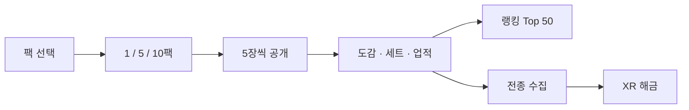

<div align="center">

# NMIXX TCG

**팩을 열고, 521장을 모으고, 먼저 완성한 사람이 1위가 되는 팬 메이드 컬렉션.**

[](https://nmixx-tcg.vercel.app)
[](https://nmixx-tcg.vercel.app)
[](#부스터)

<br/>

[](https://react.dev)
[](https://www.typescriptlang.org)
[](https://vite.dev)
[](https://tailwindcss.com)
[](https://firebase.google.com)
[](https://threejs.org)

<br/>


<br/>

[플레이](https://nmixx-tcg.vercel.app) · [화면](#화면) · [확률](#봉인율) · [랭킹](#랭킹) · [실행](#로컬에서-열기)

</div>

> [!NOTE]
> 비영리 팬 창작물입니다. 카드 이미지와 지식재산권은 원저작권자에게 있습니다. 공식 음원은 넣지 않았고, 효과음은 Web Audio로 만듭니다.

---

## 한눈에

<table>
<tr>
<td align="center" width="25%"><b>521</b><br/>도감 카드</td>
<td align="center" width="25%"><b>5</b><br/>부스터 팩</td>
<td align="center" width="25%"><b>9</b><br/>등급 C → XR</td>
<td align="center" width="25%"><b>50</b><br/>팩 천장</td>
</tr>
</table>

실물 대전은 없습니다. 팩을 사서 포토카드를 모으고, 세트와 업적을 채운 뒤 글로벌 도감 순위에 이름을 올립니다.



---

## 화면

데스크톱은 상단 탭, 휴대폰과 태블릿은 하단 탭입니다. 우편함과 소리는 둘 다 있습니다.

| | 탭 | 하는 일 |
| --- | --- | --- |
| `01` | **PACK OPEN** | 커버플로우로 팩을 고르고 개봉. 휠 · 화살표 · 방향키 |
| `02` | **COLLECTION** | 521종 필터, 정렬, 24장 페이지. 6인 컨셉 세트 탭 |
| `03` | **ACHIEVEMENTS** | 팩 전종 · 등급 · 소비 · 개봉 |
| `04` | **RANKING** | 로그인 계정 Top 50, 배지 공유 |
| `05` | **INFORMATION** | 통계, 봉입률, 쿠폰, 탈퇴 |

팩을 사면 화면 전체를 쓰는 개봉이 시작됩니다. 카드를 한 장씩 뒤집거나 모두 공개하고, 같은 팩을 이어서 살 수 있습니다. SSR 이상은 공개 연출이 붙습니다. 고등급 획득은 상단 전광판에 흐릅니다.

<details>
<summary><b>메뉴에 안 보이는 기능</b></summary>

<br/>

패치 노트, 더스트 공방, 카드 교환소는 코드에 남아 있고 지금 메뉴 버튼은 없습니다. 출석 보너스 300,000 N 계산도 상태에만 있고 헤더 버튼은 연결되어 있지 않습니다.

</details>

---

## 부스터

데이터는 `src/data/card-data/*.json`이고 `src/data/cards.ts`가 합칩니다. 화면의 수집 수는 이 장수를 기준으로 합니다.

| 코드 | 팩 | 파일 | 장수 |
| --- | --- | --- | --- |
| `NX-01` | Fe3O4: FORWARD | `op01.json` | **128** |
| `NX-02` | 2025.ver | `op02.json` | **114** |
| `NX-03` | Blue Valentine | `op03.json` | **123** |
| `NX-04` | ZERO FRONTIER | `op04.json` | **86** |
| `NX-05` | Heavy Serenade | `op05.json` | **69** |
| `HIDDEN` | 전종 보상 | `special.json` | **1** |

멤버는 릴리, 해원, 설윤, 배이, 지우, 규진, 단체, 그리고 히든 슬롯입니다.

한 팩은 5장입니다.

| 구매 | 받는 장수 | 가격 |
| --- | --- | --- |
| 1팩 | 5 | **3,800 N** |
| 5팩 | 25 | **17,100 N** |
| 10팩 | 50 | **34,200 N** |

> [!WARNING]
> `gameConfig.ts`의 `totalCards`는 위 JSON 장수와 다릅니다. 도감 계산은 JSON을 셉니다.

---

## 봉인율

가중치 합은 10,000입니다. XR은 0이라 팩에서 나오지 않습니다.

| 등급 | 호칭 | 확률 | 가공 | 도감 |
| --- | --- | --- | --- | --- |
| **C** | 일반 | 51.66% | 무광 | 62 |
| **UC** | 고급 | 30.00% | 유광 | 74 |
| **R** | 희귀 | 15.00% | 은박 | 118 |
| **SR** | 초희귀 | 2.50% | 레인보우 | 105 |
| **SSR** | 특급 | 0.45% | 파편 글래스 | 86 |
| **UR** | 극희귀 | 0.25% | 프리즘 | 45 |
| **LR** | 전설 | 0.12% | 금박 | 15 |
| **MR** | 신화 | 0.02% | 코스믹 오로라 | 15 |
| **XR** | 초월 | 팩 없음 | 초월 코스믹 | 1 |

**천장.** 50팩 동안 SSR 이상이 없으면 다음은 SSR 이상만 나옵니다. 그 안 비율은 SSR 70% · UR 20% · LR 8% · MR 2%입니다. 같은 등급에서는 그 팩 풀에서 고릅니다.

카드는 마우스를 따라 기울고, 등급이 올라갈수록 포일이 강해집니다. 도감의 작은 칸은 옅고, 팩 공개와 큰 카드에서 광택·엠보싱·입자가 납니다.

---

## 수집과 XR

컬렉션은 보유, 팩, 멤버, 등급으로 거르고 등급 · 번호 · 수량으로 정렬합니다. 페이지당 24장입니다.

컨셉 세트는 6개입니다. 같은 콘셉트의 멤버 6장을 모으면 보상 코인을 받습니다. 목록은 `sets.json`입니다.

XR 1장은 나머지 카드를 모두 모으면 들어옵니다. 그 전에는 컬렉션 가운데 배너와 인포메이션만 보여 줍니다. 인포메이션의 XR 칸은 `???`이고, "모든 카드를 수집하면 등장한다는데?"가 붙어 있습니다. 다 모으면 등급 필터, 히든 멤버, 도감 카드, 축하 창이 생기고 그대로 남습니다. XR은 1장만 가질 수 있습니다. XR 전광판은 그 카드를 가진 계정에만 보입니다.

---

## 재화 · 업적 · 랭킹

<div align="center">

| 시작 코인 | 업적 갈래 | 랭킹 |
| :---: | :---: | :---: |
| **1,000,000 N** | 🏆 ⭐ 🪙 📦 | **Top 50** |

</div>

더스트 분해·제작 수치는 설정과 공방 모달에 있습니다. MR과 XR은 제작할 수 없습니다. 공방 버튼은 지금 숨겨져 있습니다. 우편과 쿠폰은 우편함에서 받습니다.

| 아이콘 | 갈래 | 조건 |
| --- | --- | --- |
| 🏆 | 팩 전종 | NX-01 ~ NX-04 각 팩을 전부 수집 |
| ⭐ | 레어도 | C부터 MR, 그리고 XR |
| 🪙 | 골드 소비 | 1만 N → 10억 N, 6단계 |
| 📦 | 팩 개봉 | 10팩 → 100만 팩, 6단계 |

한 갈래를 전부 달성하면 랭킹 닉네임 옆에 그 아이콘이 붙습니다. XR 업적 줄은 XR을 가진 뒤에만 보입니다.

랭킹은 서로 다른 카드가 많은 순입니다. 521종을 모두 모은 사람들끼리는 **먼저 완성한 사람**이 위입니다. 완성 시각은 한 번 적히면 바꾸지 않습니다. 기능을 넣기 전에 이미 다 모은 계정은 다음 저장 때 마지막 저장 시각을 완성 시각으로 한 번 옮깁니다. 게스트와 운영자 계정은 랭킹에 올리지 않습니다. 목록에는 수집률이 낮은 봇 이름이 섞입니다.

---

## 계정과 저장

구글은 Firebase 팝업, 카카오는 Kakao SDK입니다.

| 저장소 | 컬렉션 |
| --- | --- |
| 브라우저 | `localStorage` |
| 계정 세이브 | `nmixx_tcg_users` |
| 랭킹 | `nmixx_tcg_leaderboard` |
| 전광판 | `nmixx_tcg_global_feed` |
| 교환 목록 | `nmixx_tcg_market` |

규칙은 `firestore.rules`입니다.

> [!IMPORTANT]
> 구글 로그인은 주소창 호스트가 Firebase Authorized domains에 있어야 합니다. 로컬은 `http://localhost:3000` 입니다. `127.0.0.1`은 `auth/unauthorized-domain`이 납니다. 배포 도메인 `nmixx-tcg.vercel.app`도 [인증 설정](https://console.firebase.google.com/project/nmixx-tcg/authentication/settings)에 등록되어 있어야 합니다.

로컬(`localhost`, `127.0.0.1`, `192.168.*`, `10.*`, `*.local`, Vite 개발 모드)로 열면 521종을 가진 상태로 시작하고, 그 도감을 클라우드와 랭킹에 올리지 않습니다. 배포 사이트 저장소와는 주소가 달라 서로 덮지 않습니다.

---

## 폴더

```text
src/
  App.tsx                  탭, 개봉, 모달
  pages/                   팩 · 도감 · 업적 · 랭킹 · 인포메이션
  components/Card          포일 카드, 플립, 상세
  components/Pack          팩 선택, 개봉 연출
  components/Navigation    헤더, 하단 탭, 전광판
  components/Auth          구글 · 카카오, 프로필
  components/Multiplayer   랭킹, 우편, 교환
  config/gameConfig.ts     가격, 확률, 팩
  data/card-data           카드 · 세트 JSON
  data/achievements.ts     업적, 카테고리 완료
  hooks/useGameState.ts    코인, 뽑기, 클라우드 저장
  services/                저장, 추첨, 인증, 랭킹, 소리
public/                    카드 · 팩 이미지
```

키 이름은 `.env.example`에만 적습니다. 실제 값은 Vercel Environment Variables에 둡니다.

---

## 로컬에서 열기

```bash
npm install
npm run dev
```

<div align="center">

[](http://localhost:3000)

</div>

```bash
npm run build    # 이미지 검사 → tsc → vite build
npm run preview
```

---

## 배포

`vercel.json`은 새로고침을 `index.html`로 보내고, 구글 팝업을 위해 `Cross-Origin-Opener-Policy: same-origin-allow-popups`를 붙입니다.

`배포하기.bat`은 변경을 커밋한 뒤 `main`에 푸시합니다. Vercel이 그 브랜치를 [라이브](https://nmixx-tcg.vercel.app)로 배포합니다. 푸시 전에 `.env`와 서비스 계정 키가 스테이지에 없는지 확인합니다.

<div align="center">

<br/>

**NMIXX TCG** · fan archive · not an official product

</div>
