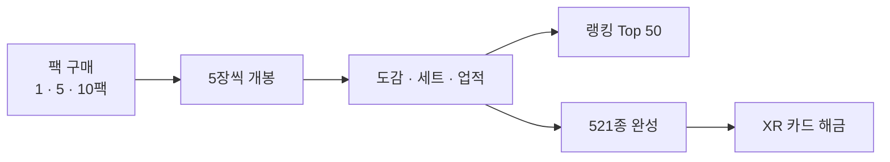

<div align="center">

# NMIXX TCG

**팩을 열고, 521장을 모으고, 먼저 완성한 사람이 1위가 되는 팬 메이드 컬렉션.**

[](https://nmixx-tcg.vercel.app)
[](#카드와-팩)
[](#카드와-팩)

[](https://react.dev)
[](https://www.typescriptlang.org)
[](https://vite.dev)
[](https://v3.tailwindcss.com)
[](https://firebase.google.com)
[](https://threejs.org)

[플레이](https://nmixx-tcg.vercel.app) · [게임 소개](#게임-소개) · [개발 시작](#개발-시작) · [문서 지도](#문서-지도) · [배포](#배포)

</div>

> [!NOTE]
> 비영리 팬 창작물입니다. 카드 이미지와 지식재산권은 원저작권자에게 있습니다. 공식 음원은 넣지 않았고, 효과음은 Web Audio로 만듭니다.

## 30초 요약

| 처음 왔다면 | 여기로 |
| --- | --- |
| 게임만 해 보고 싶다 | [nmixx-tcg.vercel.app](https://nmixx-tcg.vercel.app) |
| 어떤 게임인지 알고 싶다 | [게임 소개](#게임-소개) |
| 코드를 받아 실행하고 싶다 | [개발 시작](#개발-시작) |
| 기능을 고치거나 추가하고 싶다 | [문서 지도](#문서-지도)에서 해당 기능의 `specs/` 폴더부터 |

---

## 게임 소개

실물 대전은 없습니다. 코인으로 팩을 사서 포토카드를 모으고, 세트와 업적을 채운 뒤 글로벌 도감 순위에 이름을 올립니다.



### 화면

데스크톱은 상단 탭, 휴대폰과 태블릿은 하단 탭입니다.

| 탭 | 하는 일 |
| --- | --- |
| **PACK OPEN** | 팩을 고르고(휠 · 화살표 · 방향키) 개봉. 카드를 한 장씩 또는 한꺼번에 뒤집고, SSR 이상은 공개 연출이 붙음 |
| **COLLECTION** | 521종을 보유 · 팩 · 멤버 · 등급으로 거르고 정렬. 페이지당 24장. 컨셉 세트 탭 |
| **ACHIEVEMENTS** | 팩 전종 · 등급 · 소비 · 개봉 업적 |
| **RANKING** | 로그인 계정 Top 50, 랭킹 배지 공유 |
| **INFORMATION** | 내 통계, 봉입률 표, 쿠폰, 회원 탈퇴 |

헤더에는 우편함과 소리 버튼이 있고, 고등급 카드를 뽑으면 상단 전광판에 흐릅니다.

### 카드와 팩

한 팩은 5장입니다. 시작 코인은 **1,000,000 N**입니다.

| 코드 | 팩 | 장수 |
| --- | --- | --- |
| `NX-01` | Fe3O4: FORWARD | 128 |
| `NX-02` | 2025.ver | 114 |
| `NX-03` | Blue Valentine | 123 |
| `NX-04` | ZERO FRONTIER | 86 |
| `NX-05` | Heavy Serenade | 69 |
| `HIDDEN` | 전종 수집 보상 (팩에서 안 나옴) | 1 |

| 구매 | 받는 장수 | 가격 |
| --- | --- | --- |
| 1팩 | 5 | 3,800 N |
| 5팩 | 25 | 17,100 N (10% 할인) |
| 10팩 | 50 | 34,200 N (10% 할인) |

### 봉입률

| 등급 | 호칭 | 확률 | 가공 | 도감 장수 |
| --- | --- | ---: | --- | ---: |
| C | 일반 | 51.66% | 무광 | 62 |
| UC | 고급 | 30.00% | 유광 | 74 |
| R | 희귀 | 15.00% | 은박 | 118 |
| SR | 초희귀 | 2.50% | 레인보우 | 105 |
| SSR | 특급 | 0.45% | 파편 글래스 | 86 |
| UR | 극희귀 | 0.25% | 프리즘 | 45 |
| LR | 전설 | 0.12% | 금박 | 15 |
| MR | 신화 | 0.02% | 코스믹 오로라 | 15 |
| XR | 초월 | 팩 없음 | 초월 코스믹 | 1 |

- **천장:** 50팩 연속으로 SSR 이상이 없으면 다음 카드는 SSR 이상만 나옵니다(SSR 70 · UR 20 · LR 8 · MR 2%).
- **XR:** 나머지 520종을 모두 모으면 1장이 들어옵니다. 1장만 가질 수 있습니다.

### 수집 · 업적 · 랭킹

- **컨셉 세트 6개:** 같은 콘셉트의 멤버 6장을 모으면 코인 보상.
- **업적 4갈래:** 🏆 팩 전종(NX-01~04) · ⭐ 등급 · 🪙 코인 소비 · 📦 팩 개봉. 한 갈래를 다 채우면 랭킹 닉네임 옆에 아이콘이 붙습니다.
- **랭킹:** 서로 다른 카드가 많은 순. 521종을 다 모은 사람끼리는 **먼저 완성한 사람**이 위입니다. 게스트와 운영자 계정은 오르지 않습니다.
- **로그인:** 구글 · 카카오 · 게스트. 게스트는 브라우저에만 저장되고 랭킹 · 탈퇴 대상이 아닙니다.

<details>
<summary><b>코드에는 있지만 메뉴에 없는 기능</b></summary>

<br/>

패치 노트, 더스트 분해·제작 공방, 카드 교환소, 출석 보너스(300,000 N)는 코드와 상태에 남아 있지만 지금은 들어가는 버튼이 없습니다. 각각 `specs/015`~`018`에 정리되어 있습니다.

</details>

---

## 개발 시작

### 1. 설치와 실행

```bash
npm ci
```

```bash
npm run dev
```

[http://localhost:3000](http://localhost:3000)으로 열립니다. 확인한 환경은 Node 24 · npm 11입니다(`package.json`에 `engines` 지정은 없음).

- **`.env` 없이 실행됩니다.** `src/config/firebase.ts`에 Firebase · Kakao 공개 키 기본값이 들어 있습니다. 다른 프로젝트에 붙이려면 `.env.example`을 복사해 `.env`를 만듭니다.
- **개발 서버도 운영 Firestore(`nmixx-tcg`)에 연결됩니다.** 다른 사용자의 문서를 쓰거나 지우는 코드를 넣지 마세요.
- 로컬 주소(`localhost`, `127.0.0.1`, 사설 IP, `*.local`)로 열면 521종을 모두 가진 상태로 시작하고, 그 도감은 클라우드와 랭킹에 올리지 않습니다.
- 구글 로그인은 `localhost:3000`에서만 됩니다. `127.0.0.1`로 열면 `auth/unauthorized-domain` 오류가 납니다.

### 2. 검사와 빌드

자동 테스트는 없습니다. 아래 두 가지가 빌드 가드입니다.

| 명령 | 하는 일 |
| --- | --- |
| `npx tsc --noEmit` | 타입 검사 |
| `node scripts/verify_images.cjs` | 코드 속 이미지 경로가 `public/`과 대소문자까지 일치하는지 검사 |
| `npm run build` | 위 두 검사 → `vite build`. 결과물은 `dist/` |
| `npm run preview` | `dist/` 미리보기 |

> [!WARNING]
> Tailwind는 **v3에 고정**되어 있습니다(`~3.4.17`). v4로 올리면 PostCSS 설정이 맞지 않아 배포 빌드가 실패합니다. 실제로 2026-10-19부터 약 한 달간 배포가 멈췄습니다(`docs/decisions.md` DEC-025). 의존성을 바꾼 뒤에는 `npm install`이 아니라 `npm ci` → `npm run build`로 확인하세요.

### 3. 자주 고치는 곳

| 하고 싶은 일 | 고칠 곳 |
| --- | --- |
| 카드 · 세트 추가 | `src/data/card-data/*.json`만. 기존 카드 `id`는 절대 바꾸거나 지우지 않음 |
| 가격 · 확률 · 천장 변경 | `src/config/gameConfig.ts`, 추첨 가중치는 `src/services/rngService.ts`도 함께 |
| 게임 상태 변경 로직 | `src/hooks/useGameState.ts` (컴포넌트에서 `localStorage` · Firestore 직접 사용 금지) |
| Firestore 컬렉션 추가 | 이름은 `nmixx_tcg_*`, `firestore.rules`에 규칙도 추가 |

카드 이미지는 `public/`에 `.webp`로 두고, JSON의 `image` 경로와 대소문자까지 맞춰야 빌드가 통과합니다.

### 폴더

```text
src/
  types/            타입 계약 원본 (Card, GameState, 인증, 멀티플레이)
  config/           gameConfig.ts(가격·확률·팩), firebase.ts
  data/card-data/   카드 · 세트 JSON
  data/             카드 병합, 업적, 패치노트, 이스터에그
  services/         추첨, 저장, 클라우드 동기화, 인증, 랭킹 · 우편 · 교환, 소리
  hooks/            useGameState.ts — 게임 상태의 유일한 변경 지점
  pages/            탭 화면 5개
  components/       카드, 팩, 내비게이션, 로그인, 랭킹 · 우편 등
public/             카드 · 팩 이미지
scripts/            verify_images.cjs(빌드 가드), 일회성 운영 스크립트
docs/ · specs/      제품 · 결정 · 기능 명세 (아래 문서 지도)
```

---

## 문서 지도

이 프로젝트는 **명세 주도(SDD)** 로 유지보수합니다. 코드를 고치기 전에 해당 기능의 명세를 먼저 읽고, 바뀐 내용은 명세에도 반영합니다.

| 문서 | 내용 | 언제 읽나 |
| --- | --- | --- |
| [`CLAUDE.md`](CLAUDE.md) | 기술 스택, 확인된 명령, 코딩 규칙, 하지 말 것 | 가장 먼저. 사람과 AI 모두 |
| [`docs/product.md`](docs/product.md) | 제품 정의, 범위, 기능 목록 21개, 미결 질문 | 무엇을 왜 만드는지 볼 때 |
| [`docs/decisions.md`](docs/decisions.md) | 결정 기록 DEC-001~025 (근거 커밋 포함) | "왜 이렇게 되어 있지?" 싶을 때 |
| [`specs/NNN-기능/`](specs) | 기능별 요구사항 · AC · 설계 · 작업 · 검증 기록 | 그 기능을 고칠 때 |

### 기능별 명세

큰 기능은 `spec.md` · `plan.md` · `tasks.md` 세 문서(Full), 작은 기능은 `spec.md` 한 장(Lite)입니다.

| 영역 | 기능 |
| --- | --- |
| 카드 · 뽑기 | [001 카드 카탈로그](specs/001-card-catalog/spec.md) · [002 팩 구매와 추첨](specs/002-pack-draw/spec.md) · [003 개봉 연출](specs/003-pack-opening/spec.md) · [015 더스트](specs/015-dust-craft/spec.md) |
| 수집 · 보상 | [004 도감](specs/004-collection/spec.md) · [005 컨셉 세트](specs/005-concept-set-reward/spec.md) · [006 XR 보상](specs/006-xr-reward/spec.md) · [009 업적](specs/009-achievements/spec.md) · [018 출석 보너스](specs/018-daily-bonus/spec.md) · [019 이스터에그](specs/019-easter-eggs/spec.md) |
| 계정 · 저장 | [007 로그인](specs/007-auth/spec.md) · [008 저장과 동기화](specs/008-save-sync/spec.md) · [013 프로필](specs/013-profile/spec.md) · [014 회원 탈퇴](specs/014-account-deletion/spec.md) |
| 소셜 | [010 랭킹](specs/010-leaderboard/spec.md) · [011 전광판](specs/011-pull-ticker/spec.md) · [012 우편과 쿠폰](specs/012-mailbox-coupon/spec.md) · [016 카드 교환](specs/016-card-trade/spec.md) · [020 배지 공유](specs/020-share-badge/spec.md) |
| 기타 화면 | [017 패치노트](specs/017-patch-notes/spec.md) · [021 정보 탭](specs/021-information/spec.md) |

### 작업 흐름

Claude Code에서는 `.claude/commands/`의 슬래시 명령으로 단계를 실행합니다. 다른 도구를 쓴다면 명령 파일 본문을 프롬프트로 붙여넣어도 됩니다.

```text
새 기능:   /sdd-spec → /sdd-clarify → /sdd-plan → /sdd-tasks → /sdd-implement → /sdd-verify
기능 변경: /sdd-change → /sdd-implement → /sdd-verify
```

- 모르는 것은 추측하지 않고 `[확인 필요: …]`로 남깁니다.
- 실제로 실행하지 않은 검증은 "통과"로 적지 않습니다.
- 구조에 영향을 주는 결정은 `docs/decisions.md`에 DEC 번호로 남깁니다.

---

## 배포

`main`에 푸시하면 Vercel이 [nmixx-tcg.vercel.app](https://nmixx-tcg.vercel.app)으로 자동 배포합니다. 성공 여부는 GitHub 커밋 옆의 `Vercel` 상태로 확인합니다.

- `vercel.json`은 새로고침을 `index.html`로 보내고, 구글 로그인 팝업을 위해 `Cross-Origin-Opener-Policy: same-origin-allow-popups`를 붙입니다.
- 운영 키는 Vercel Environment Variables에 둡니다.
- 배포 도메인은 Firebase 콘솔의 [Authorized domains](https://console.firebase.google.com/project/nmixx-tcg/authentication/settings)에 등록되어 있어야 구글 로그인이 됩니다.

> [!CAUTION]
> `배포하기.bat`은 `git add .`로 **모든 변경을 확인 없이** 커밋하고 푸시합니다. 쓰기 전에 `git status`로 `.env` · `.env.production` · 서비스 계정 키가 올라가지 않는지 확인하세요. 가능하면 직접 `git add <파일>`로 커밋하는 편이 안전합니다.

<div align="center">

<br/>

**NMIXX TCG** · fan archive · not an official product

</div>
